  <a href="https://github.com/ulaer">🇹🇷 Türkçe</a> &nbsp;·&nbsp; <b>🇬🇧 English</b>

  

  
  
  

### 👋 Hi, I'm ulaer

I build **clean, well-tested desktop apps** and like putting **AI to practical use**.
Right now I'm working on tools that help people learn languages by doing, not memorizing.

---

### 🚀 Featured project

<table>
  <tr>
    <td width="55%">
      
    </td>
    <td width="45%" valign="top">
      <h3><a href="https://github.com/ulaer/lingora">Lingora</a></h3>
      
A Windows app that improves your English writing and reading through sentence-by-sentence translation.

      <ul>
        <li>🧠 Scoring, corrections and explanations by Gemini</li>
        <li>📖 A personal dictionary that fills itself from your mistakes</li>
        <li>🎯 Daily goal, streaks and progress tracking</li>
        <li>🔐 API key encrypted with Windows DPAPI</li>
        <li>✅ 170 automated tests, including the WPF UI</li>
      </ul>
      

        
        
        
      

      
<a href="https://github.com/ulaer/lingora"><b>View the project →</b></a>

    </td>
  </tr>
</table>

---

### 🛠️ Tech stack

  
  
  
  
  
  
  
  
  

### 🧭 How I work

- **Tests first:** business logic is separated from the UI; time, network and file access are injected so they can be tested.
- **Privacy and security:** keys never go into code, and user data stays on the user's machine.
- **Simple UI:** no clutter; the screen shows the user what to do next.

### 🌱 Currently

- 🔭 Adding new features to **Lingora**.
- 📚 Exploring AI-assisted learning tools and structured LLM output.
- 🤝 Open to feedback and collaboration: reach me on [LinkedIn](https://www.linkedin.com/in/kemal-ergin-714057241) or open an [issue](https://github.com/ulaer/lingora/issues).

---

  ulaer · Software Developer · <a href="https://github.com/ulaer">Türkçe oku</a>

