  

  
  
  

### 👋 Hi, I'm ulaer

I'm a software developer who builds **clean, well-tested desktop apps** and likes putting
**AI to practical use**. Right now I'm building tools that help people learn languages
by doing, not memorizing.

**Merhaba!** Ben bir yazılım geliştiriciyim. Sade arayüzlü, **testleri yazılmış masaüstü uygulamaları**
geliştiriyor ve **yapay zekâyı gerçek bir işe yarayacak şekilde** kullanmayı seviyorum.
Şu an insanların ezber yerine pratikle dil öğrenmesini sağlayan araçlar üzerinde çalışıyorum.

---

### 🚀 Öne çıkan proje · Featured project

<table>
  <tr>
    <td width="55%">
      
    </td>
    <td width="45%" valign="top">
      <h3><a href="https://github.com/ulaer/lingora">Lingora</a></h3>
      
Cümle cümle çeviri yaparak İngilizce yazma ve okuma becerini geliştiren Windows uygulaması.
       <i>A Windows app that improves your English through sentence-by-sentence translation, graded by Gemini.</i>

      <ul>
        <li>🧠 Gemini ile puanlama, düzeltme ve Türkçe açıklama</li>
        <li>📖 Hatalardan otomatik dolan kişisel sözlük</li>
        <li>🎯 Günlük hedef, seri ve ilerleme takibi</li>
        <li>🔐 DPAPI ile şifreli API anahtarı</li>
        <li>✅ 170 otomatik test (WPF arayüzü dahil)</li>
      </ul>
      

        
        
        
      

      
<a href="https://github.com/ulaer/lingora"><b>Projeyi incele →</b></a>

    </td>
  </tr>
</table>

---

### 🛠️ Kullandığım teknolojiler · Tech stack

  
  
  
  
  
  
  
  
  

### 🧭 Nasıl çalışırım · How I work

- **Önce test:** iş mantığı arayüzden ayrı; zaman, ağ ve dosya erişimi test edilebilir şekilde enjekte edilir.
- **Gizlilik ve güvenlik:** anahtarlar asla koda girmez, kullanıcı verisi kullanıcının bilgisayarında kalır.
- **Sade arayüz:** gereksiz süs yok; kullanıcı ne yapacağını ekranda görür.

### 🌱 Şu an · Currently

- 🔭 **Lingora**'ya yeni özellikler ekliyorum.
- 📚 Yapay zekâ destekli öğrenme araçları ve yapılandırılmış LLM çıktıları üzerine çalışıyorum.
- 🤝 Geri bildirime ve iş birliğine açığım: [LinkedIn](https://www.linkedin.com/in/kemal-ergin-714057241)'den yazabilir ya da bir [issue](https://github.com/ulaer/lingora/issues) açabilirsin.

---

  ulaer · Software Developer

